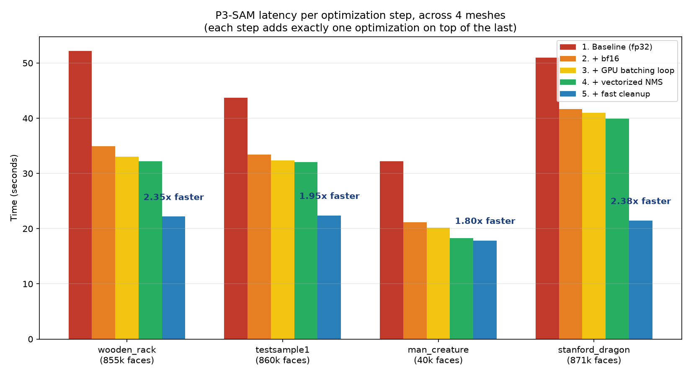
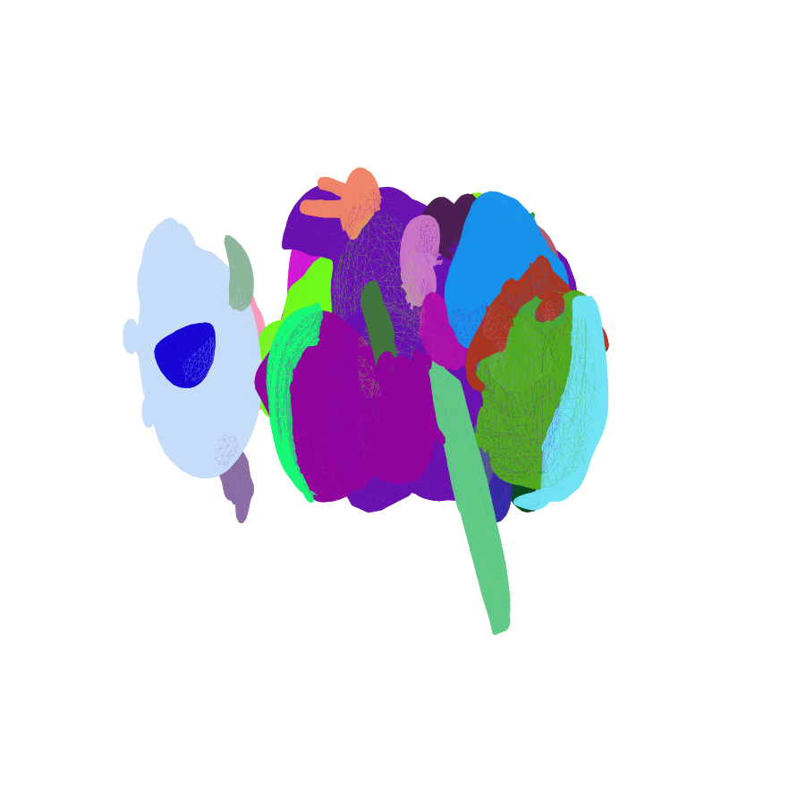
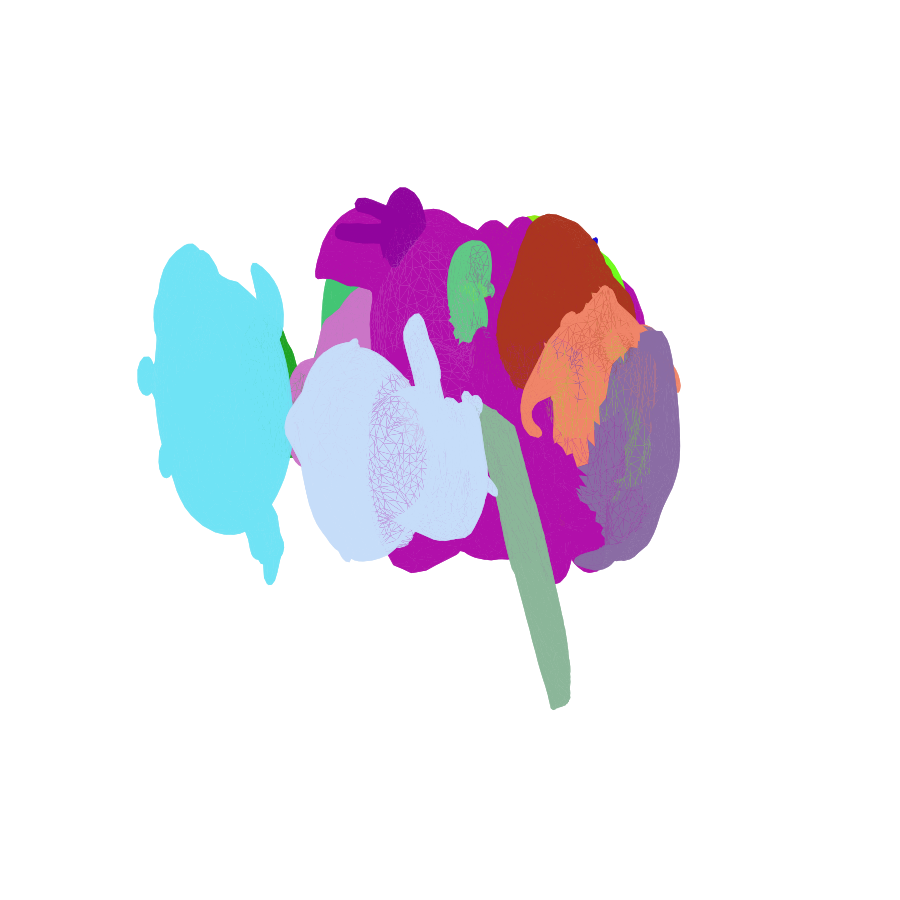
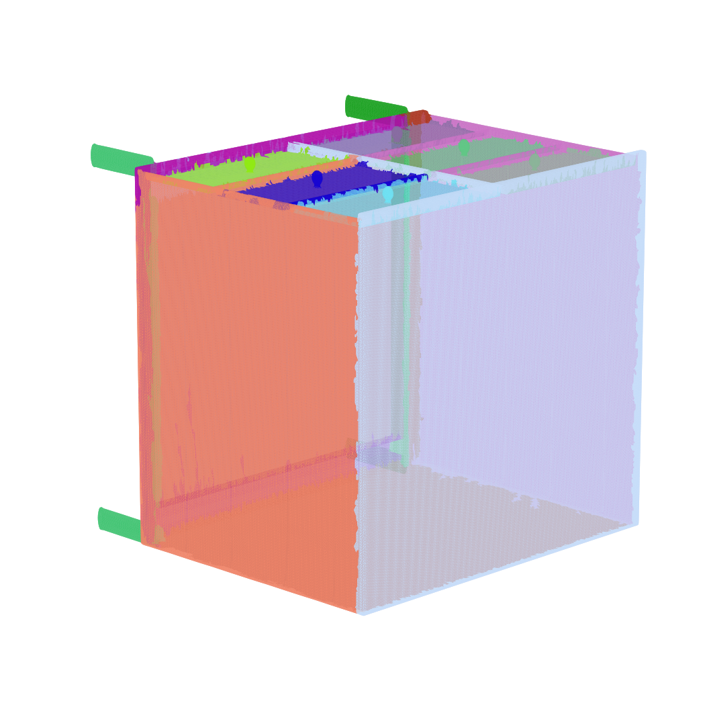

# Part Segmentation

Optimized P3-SAM segmentation pipeline + the X-Part generative part-decomposition
pipeline wired to use it, based on [Tencent's Hunyuan3D-Part](https://github.com/Tencent-Hunyuan/Hunyuan3D-Part).
See `LICENSE` / `NOTICE` for the original project's license terms (TENCENT HUNYUAN
NON-COMMERCIAL LICENSE AGREEMENT) -- this repo is a derivative work under those terms.

## What's in here

- **`P3-SAM/`** -- the optimized P3-SAM segmentation pipeline.
  - `demo/auto_mask_fast.py` -- optimized pipeline (see "P3-SAM optimizations" below).
  - `demo/auto_mask.py` -- original baseline, kept for reference/comparison.
  - `demo/run_p3sam_for_xpart.py` -- standalone script that runs the optimized
    pipeline on a mesh and saves the predicted part bounding boxes as a `.npy`,
    for use by X-Part (see below).
  - `model.py` -- the P3-SAM model definition (unmodified).
- **`XPart/`** -- X-Part's generative part-decomposition pipeline, patched to:
  1. use the optimized P3-SAM pipeline above for its internal bbox-prediction
     step (`partgen/bbox_estimator/auto_mask_api.py`) instead of its own
     bundled, unoptimized, buggy copy,
  2. accept a precomputed bbox via `--aabb_path` (`demo.py`) so P3-SAM can be
     run standalone first, with the full GPU to itself, instead of competing
     for memory with X-Part's own much larger models,
  3. process parts in small batches instead of all at once in several places
     that otherwise pin GPU memory at its ceiling on multi-part meshes:
     the diffusion denoising loop (`partformer_pipeline.py`), the per-part
     conditioning encoder (`partgen/models/autoencoders/model.py`), and the
     nearest-point matching step (`partgen/models/conditioner/condioner_release.py`).
  4. keep the sonata/spconv segmentation-feature backbone in fp32 while the
     rest of the pipeline runs in bf16 (spconv has no bf16 dtype mapping for
     some of its internal tensors).
- **`outputs/`** -- the two generated results referenced by this repo:
  - `generated_parts_assembled_50step.glb` -- full quality, 50 diffusion steps,
    produced before the part-chunking fix (X-Part's own internal bbox predictor
    replaced with the optimized P3-SAM one, but diffusion still unchunked).
  - `generated_parts_assembled_chunked20step.glb` -- 20 diffusion steps, with
    the part-chunked diffusion loop active (smoke-tested fix validating the
    ~50-70x per-step speedup from chunking).

## P3-SAM optimizations (`auto_mask_fast.py` vs `auto_mask.py`)

P3-SAM segments a mesh into parts in four stages: sample points from the
surface -> run the network on batches of "prompt" points to propose candidate
masks -> merge/de-duplicate overlapping candidates (NMS) -> clean up the final
per-face labels. Four changes were made, each targeting a different stage,
and each was isolated and measured on its own (not just measured as a single
before/after number) so the contribution of each one is known individually.

### 1. Fixed a hard-coded settings bug

The original `mesh_sam()` silently overwrote the caller's `point_num` /
`prompt_num` arguments with hard-coded values (`100000` / `400`) a few lines
after accepting them as parameters. Any attempt to tune those settings for
speed (e.g. fewer prompts) had **zero effect** -- the function always ran at
the hard-coded values regardless of what was passed in. This was found by
noticing an earlier "prompt_num 400 vs 200, no speedup" test result was
suspiciously flat, then confirmed by reading the code. Fixed by removing the
override.

### 2. bf16 precision for the network pass

The main network inference pass (sampling the network over every batch of
prompt points) now runs under `torch.autocast("cuda", dtype=torch.bfloat16)`
instead of full fp32. This is the single biggest win -- bf16 keeps fp32's
dynamic range (unlike fp16, see note below) but halves the memory per value
and the GPU executes it roughly 2x faster per op. The one place that is
*excluded* from bf16 is the NMS overlap-check matmul (see #3), which is
wrapped in `torch.autocast(..., enabled=False)` to force it back to fp32 --
that computation needs full precision to avoid silently over-merging parts
(found via a real regression on the Stanford Dragon test: 3 parts collapsed
into 1 under bf16 NMS, fixed by excluding just that one op).

**Why not fp16 instead of bf16?** Tested explicitly: fp16's much smaller
dynamic range caused severe underflow/overflow in the network's intermediate
activations, collapsing segmentation output on every test mesh (e.g. 15 parts
-> 1 part, 22 parts -> 2 parts). fp16 was rejected outright after this test;
bf16 was kept as the only precision change.

### 3. Vectorized NMS

The overlap-check between candidate masks (deciding which proposals to merge)
originally compared every pair of candidates one at a time in a Python loop
on the CPU. It now computes all pairwise overlaps in one GPU matrix
multiplication (`mask_matrix @ mask_matrix.T`), turning an O(n^2) Python loop
into a single batched GPU op.

### 4. Fast cleanup (SciPy connected components)

The final step groups connected faces into parts so that each part is one
solid region, not scattered fragments. The original code did this with a
hand-written breadth-first search in plain Python. It now uses SciPy's
compiled `scipy.sparse.csgraph.connected_components` -- verified to produce
**bit-identical** output to the original on every test mesh, so this is a
pure speedup with no behavior change at all. Its benefit scales with mesh
size: negligible on a 40k-face mesh, but the single largest contributor on
every 850k+ face mesh tested (see table below), because the Python loop's
cost grows much faster than the compiled routine's as face count increases.

### Measured latency, broken down per step, across 4 meshes

Each mesh below was run through 5 configurations in order, each one adding
exactly one more optimization on top of the last, so the time difference
between consecutive rows isolates that one change's contribution. Same
settings throughout (`prompt_num=400`, `point_num=100000`), varying only
which optimizations are active:



| Mesh | 1. Baseline (fp32) | 2. + bf16 | 3. + GPU batching loop | 4. + vectorized NMS | 5. + fast cleanup | **Total speedup** |
|---|---|---|---|---|---|---|
| wooden_rack (854,832 faces) | 52.18s | 34.94s (+17.24s) | 33.01s (+1.93s) | 32.19s (+0.82s) | **22.18s (+10.02s)** | **2.35x** |
| testsample1 (860,218 faces) | 43.71s | 33.41s (+10.30s) | 32.36s (+1.05s) | 32.07s (+0.29s) | **22.38s (+9.69s)** | **1.95x** |
| man_creature (40,000 faces) | 32.21s | 21.13s (+11.08s) | 20.16s (+0.97s) | 18.30s (+1.87s) | **17.86s (+0.44s)** | **1.80x** |
| stanford_dragon (871,306 faces) | 50.99s | 41.65s (+9.34s) | 41.01s (+0.64s) | 39.94s (+1.07s) | **21.45s (+18.50s)** | **2.38x** |

(`+X.XXs` = time saved by that specific step over the previous row, i.e. that
step's individual contribution to the total speedup.)

**Average contribution per optimization**, across all 4 meshes:
- bf16 precision: **9.3 - 17.2s saved** -- the single biggest win, ~20-35% of total runtime.
- GPU batching loop (uploading points once, keeping data on GPU between batches): **~0.6 - 2.0s** -- small, consistent.
- Vectorized NMS: **~0.3 - 1.9s** -- small; matters more with many candidate masks.
- Fast cleanup: **0.4s on the 40k-face mesh, up to 18.5s on 850k+ face meshes** -- scales strongly with mesh size, the second-biggest win overall and the single largest one on every large mesh tested.

### Validating output quality, not just speed

Speed changes are only useful if the result is still correct, so every
optimization was checked against the baseline, not just timed:

- **Fast cleanup (#4)** was checked face-by-face against the original
  Python BFS and found to produce **bit-identical** part labels on every
  test mesh -- a pure speedup with provably zero quality change.
- **bf16 (#2)** causes small, expected run-to-run part-count variance
  (typically +-1-2 parts) because GPU floating-point reduction order isn't
  perfectly fixed even at a fixed seed under bf16 -- this is normal GPU
  non-determinism, not a bug, and was confirmed by re-running the same mesh
  multiple times and observing the same +-1-2 spread with *or without* any
  of these optimizations active.
- **fp16 was tested and rejected** (see #2) specifically because it failed
  this check: it didn't just run faster or slower, it visibly broke
  segmentation quality (parts collapsing together), which is exactly the
  kind of regression this validation step exists to catch.
- Example segmentation output (same mesh, original vs. optimized pipeline --
  structurally equivalent part decomposition):

  | Original (`auto_mask.py`) | Optimized (`auto_mask_fast.py`) |
  |---|---|
  |  |  |

  Another example on a hard-surface mesh (wooden rack, 854,832 faces),
  showing clean part boundaries preserved at speed:

  

## X-Part part-chunking fix

X-Part's diffusion denoising loop processes all detected parts through its
21-layer transformer in a single batch, every one of (by default) 50 steps.
On meshes that decompose into ~20+ parts this pins GPU memory at its ceiling,
which on Windows can silently trigger NVIDIA's "CUDA sysmem fallback" (spilling
to system RAM over PCIe instead of erroring) -- the process doesn't crash, it
just runs 50-70x slower with no warning. Processing parts in small batches
(default 6, configurable via `XPART_DIFFUSION_PART_CHUNK` env var) instead of
all at once keeps peak memory bounded regardless of part count. Measured
per-step diffusion time: ~250-350s/step unchunked -> ~5s/step chunked, on the
same RTX 4080 Laptop GPU (12GB) and the same 23-part test mesh.

The DiT has no cross-part attention mixing (self/cross-attention run per-part
along the batch axis), so chunking the batch dimension doesn't change what the
model computes for each part.

## Reproducing the two output files

```bash
# 1. Run P3-SAM standalone (fast, full GPU) to get the part bounding boxes
cd P3-SAM/demo
python run_p3sam_for_xpart.py
# -> writes XPart/results/precomputed_aabb_000.npy

# 2a. generated_parts_assembled_50step.glb -- full quality, 50 steps,
#     default chunk size (6)
cd ../../XPart
python demo.py --config partgen/config/infer.yaml \
    --mesh_path ./data/000.glb --save_dir ./results/ \
    --aabb_path ./results/precomputed_aabb_000.npy \
    --num_inference_steps 50

# 2b. generated_parts_assembled_chunked20step.glb -- fast smoke test that
#     validated the chunking fix, 20 steps, chunk size 4
XPART_DIFFUSION_PART_CHUNK=4 python demo.py --config partgen/config/infer.yaml \
    --mesh_path ./data/000.glb --save_dir ./results_smoketest/ \
    --aabb_path ./results/precomputed_aabb_000.npy \
    --num_inference_steps 20
```

Both runs used the same `data/000.glb` input mesh and the same precomputed
`aabb` from step 1 -- they differ only in step count and chunk size, both now
exposed as CLI flags (`--num_inference_steps`, `XPART_DIFFUSION_PART_CHUNK`
env var) instead of being hardcoded.

Requires the pretrained weights, auto-downloaded from HuggingFace
(`tencent/Hunyuan3D-Part`) on first run. See each subproject's own
`requirements.txt` for dependencies.
